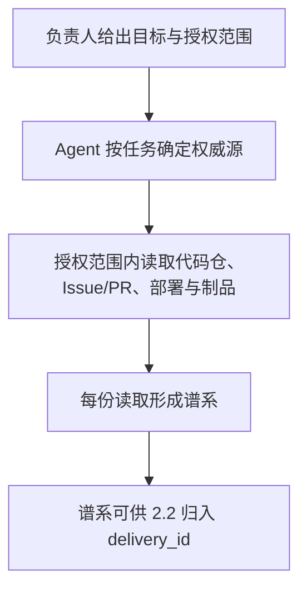

# 1.1 上下文管道

## 1. 业务目标

企业要把 AI Agent 接入需求到上线的闭环时，Agent 必须能按当前任务拿到**权威、新鲜、可追溯**的上下文。人给出目标与授权范围，不充当材料搬运工。

本期在仓库 `Izelzzz/izel-ai-native` 上做企业实验校验：在一次「小功能改动到 preview」的任务里，证明上下文管道成立。成功状态可观察为：Agent 在授权范围内自行读到代码仓、Issue/PR、部署与制品状态，且每份读取都能核验来源、版本或哈希、读取时刻与读取身份。

本篇与 [2.2 交付可还原](./2.2-交付可还原-产品规格.md) 同属这一次实验，验收分开。本篇形成可核验谱系；2.2 按 `delivery_id` 归集时间线并还原交付。谱系在读取时成立，供 2.2 引用。

**已确认：** 方向为上下文管道（按任务取真相），与格造社命题 13（安全可控上下文工程）对齐。本篇验收尺子是授权范围内自取且谱系可核验。1.1 与 2.2 分篇。度量读法在独立规格中单独验收。

**假设：** 代码仓 Issue/PR、部署与制品状态可作为第一期权威源；人机双写由既有工具在事件发生时写入，Agent 自取。

**待确认（责任人：Izel；期限：方案冻结前）：** 试点「小功能到 preview」落在哪一个真实应用仓库。

## 2. 业务结构

### 角色、场景与范围

- **角色：** 项目负责人（Izel）给出任务并划定授权范围；工程 Agent 在该范围内按任务自取权威上下文。
- **场景：** 一次小功能走向 preview 时，Agent 取得该任务当时需要的权威上下文。
- **本期包含：** 权威语义；授权范围内的自取；代码仓、Issue/PR、部署与制品状态的谱系与新鲜度。
- **依赖项：** 仓库与部署环境能给出代码、Issue/PR、制品与部署状态；Agent 具备可判定的身份与授权范围。2.2 引用本篇谱系。
- **与 2.2 的衔接：** 本篇回答「这份上下文是谁在何时以何种身份读到的哪一版」。交付时间线、preview 成败与回滚写在 2.2。

### 流程与路径

主路径：负责人给出目标与授权范围 → Agent 按当前任务确定要读的权威源 → 在授权范围内读取代码仓、Issue/PR、部署与制品状态 → 每份读取形成谱系 → 谱系可供 2.2 归入 `delivery_id`。

## 3. 用户故事

1. 作为项目负责人，在要用 Agent 做一次小功能到 preview 时，需要 Agent 自己按任务取到权威且不过期的上下文，以便人不用当材料搬运工。
2. 作为项目负责人，在 Agent 取完上下文后，需要每份读取都能核验来源、版本、读取时刻与身份，以便 2.2 还原「用了哪份上下文」时有据可依。
3. 作为审查方，在抽检这次任务的上下文时，需要对照授权范围与谱系，以便确认读取落在授权内，且版本与任务绑定一致。

## 4. 功能清单

| 能力 | 业务规则 | 对应故事 | 备注 |
|------|----------|----------|------|
| 权威语义 | 任务可引用的上下文，是事件发生时写入、可被查询的系统记录，并带身份与版本或哈希 | 故事 1、2 | 第一期源：代码仓、Issue/PR、部署与制品 |
| 授权内自取 | Agent 按当前任务，只读取已授权范围内的上述权威源 | 故事 1、3 | |
| 读取谱系 | 每份读取带来源、版本或哈希、读取时刻与身份，可核验「谁在何时以何种身份读到哪一版」 | 故事 2、3 | 供 2.2 引用 |
| 新鲜度 | 被引用的版本与当前任务绑定一致；不一致时重新取源，并以新谱系作为后续引用 | 故事 1、3 | |

## 5. 边界与异常

| 情形 | 业务预期 |
|------|----------|
| 某权威源不可读或授权不足 | 告知缺哪一项权限或哪一个源；该源不形成可引用谱系，并记下未取得的原因 |
| 上下文已过期，或版本与任务绑定不一致 | 告知需重新取源；以新的可核验读取作为该任务的引用 |
| 任务所需的源超出当前授权 | 告知缺口；等待负责人扩大授权或收窄任务后再读 |

## 6. 验收标准

1. 负责人发起一次「小功能到 preview」任务后，Agent 在授权范围内完成自取；代码仓、Issue/PR、部署与制品中，任务实际读到的每一份都带有来源、版本或哈希、读取时刻与读取身份。（故事 1、2）
2. 审查方可凭谱系核验「谁在何时以何种身份读到哪一版」，且该次读取落在当时的授权范围内。（故事 3）
3. 第 5 节各情形的业务预期即为该情形的验收。

## 7. 术语表

| 术语 | 在本规格中的含义 | 不包括 | 边界 |
|------|------------------|--------|------|
| 上下文管道 | 按任务从权威源自取、并带谱系的上下文供给 | 企业级知识总图或门户 | 第一期源：代码仓、Issue/PR、部署与制品 |
| 权威源 | 事件发生时人机双写、可被 Agent 查询的系统记录 | 事后粘贴进对话的临时材料 | 须有身份与版本或哈希 |
| 谱系 | 一次读取的来源、版本或哈希、读取时刻与身份 | 交付成败、回滚与 `delivery_id` 时间线 | 时间线上的引用由 2.2 归集 |
| 新鲜 | 引用的版本与当前任务绑定一致 | 以过期读取继续被任务引用 | 不一致则重新取源 |
| 授权范围 | 负责人为本任务划定、Agent 据以读取的边界 | 读取发生之后再补记的权限 | 范围不足时先告知再等待人调整 |

## 8. 决策日志

| 时间 | 变更点 | 理由 | 决策人 |
|------|--------|------|--------|
| 2026-10-16 | 方向定为上下文管道（按任务取真相）；场景钉小功能到 preview；权威源含代码仓、Issue/PR、部署与制品 | 本期验的是授权内自取与谱系；知识总图后置 | 群共识，待 Izel 书面确认 |
| 2026-10-16 | 产品押题对齐格造社命题 13（安全可控上下文工程）；本篇验收为自取且谱系可核验 | 与 1.1 同构 | 福尔摩斯提案，工程/运维同边 |
| 2026-10-16 | 1.1 与 2.2 分篇、各自验收。本篇形成谱系；`delivery_id` 时间线归 2.2。度量规格维持独立轨道（#1） | 两篇尺子不同，避免一篇规格同时背两问 | Izel，经由工程负责人转达 |
