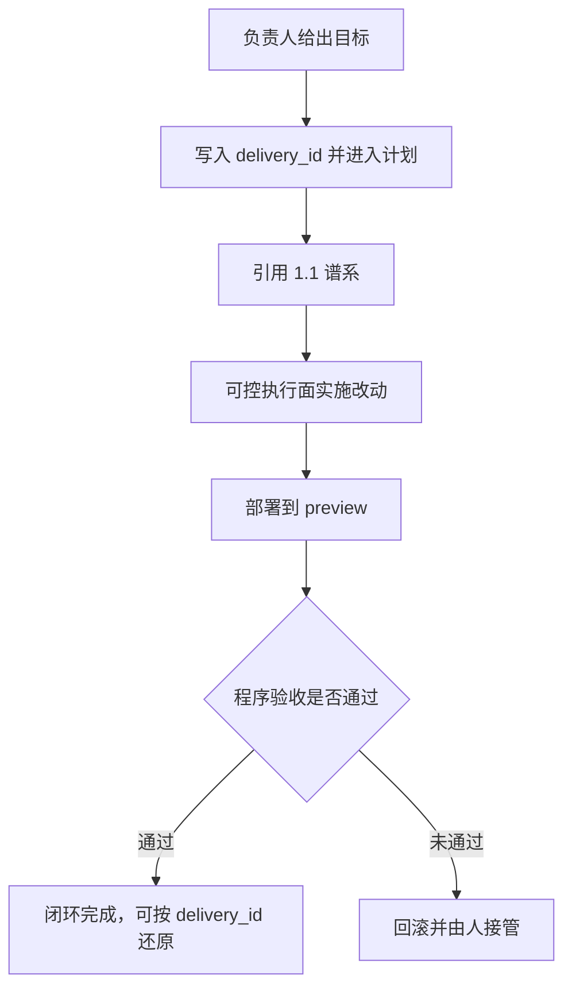

# 2.2 交付可还原

## 1. 业务目标

企业要把 AI Agent 接入需求到上线的闭环时，事后必须能还原「用了什么、谁授权、改了什么、结果是否对得上」。

本期在仓库 `Izelzzz/izel-ai-native` 上做企业实验校验：跑通一次「小功能改动到 preview」的闭环，证明交付可还原。成功状态可观察为：任一已完成的闭环，都能用同一条 `delivery_id` 时间线还原上述四问；preview 未通过时进入回滚，并由人接管。

本篇与 [1.1 上下文管道](./1.1-上下文管道-产品规格.md) 同属这一次实验，验收分开。时间线上的「用了哪份上下文」引用 1.1 已经形成的谱系。上下文如何读取、何为权威，以 1.1 为准。

**已确认：** 验收尺子是同一条 `delivery_id` 可还原，与格造社命题 10（轨迹评估归因）对齐。1.1 与 2.2 分篇。度量读法在独立规格中单独验收。

**假设：** 1.1 能在任务执行时提供可核验谱系；preview 环境能给出制品与部署状态，供程序验收对照；Agent 具备可判定的身份与授权依据。

**待确认（责任人：Izel；期限：方案冻结前）：** 试点「小功能到 preview」落在哪一个真实应用仓库。

## 2. 业务结构

### 角色、场景与范围

- **角色：** 项目负责人（Izel）发起与验收；工程 Agent 在授权范围内把改动做到 preview；preview 失败时由人接管。
- **场景：** 一次小功能从需求意图到 preview 可访问，且交付证据链完整。
- **本期包含：** 系统 Trace；Agent 动作审计；同一 `delivery_id` 上的 plan、apply、verify、rollback；preview 的程序验收；失败后的回滚与人接管；可控执行面。
- **依赖项：** 1.1 提供可核验谱系；仓库与 preview 环境能给出制品与部署状态；Agent 具备可判定的身份与授权依据。
- **与 1.1 的衔接：** 本篇消费 1.1 谱系，用来回答「用了哪份上下文」。谱系的形成规则写在 1.1。

### 流程与路径

主路径：负责人给出目标 → 写入 `delivery_id` 并进入计划，同时引用 1.1 谱系 → 在可控执行面实施改动 → 部署到 preview → 程序验收（部署与制品、接口与数据、页与客户端信号）→ 通过则闭环完成，可按 `delivery_id` 还原；未通过则回滚，并由人接管。

## 3. 用户故事

1. 作为项目负责人，在一次闭环结束后，需要按同一条 `delivery_id` 看到「用了哪份上下文、谁授权、改了什么、结果是否对得上」，以便验收和复盘。
2. 作为项目负责人，在 preview 未通过时，需要系统回滚并交回给人，以便后续生产向推进由人决定。
3. 作为审查方，在事故或抽检时，需要用同一份证据按 `delivery_id` 反查，以便判断质量门槛是否守住。

## 4. 功能清单

| 能力 | 业务规则 | 对应故事 | 备注 |
|------|----------|----------|------|
| 交付证据链 | 同一次闭环的 plan、apply、verify、rollback（若发生）挂在同一 `delivery_id` | 故事 1、3 | |
| 上下文引用 | 时间线上「用了哪份上下文」引用 1.1 谱系，与该次读取为同一份证据 | 故事 1 | 消费 1.1 |
| Agent 动作审计 | 每次动作及其授权依据写入同一时间线，供归因「谁授权、改了什么」 | 故事 1、3 | 与命题 10 对齐 |
| 系统 Trace | 计划、执行、验收、回滚的轨迹按时间归入同一 `delivery_id` | 故事 1、3 | |
| Preview 验收 | 部署与制品、接口与数据一致性、页与客户端信号都通过，preview 才算通过 | 故事 1、2 | 任一未通过即失败 |
| 失败接管 | Preview 失败后回滚，并把控制权交还负责人；此后生产向推进由人发起 | 故事 2 | |
| 事故反查 | 按 `delivery_id` 查询到的内容与日常时间线是同一份证据 | 故事 3 | |

## 5. 边界与异常

| 情形 | 业务预期 |
|------|----------|
| 进入 apply 时，时间线上还没有 1.1 的可核验谱系 | 告知缺谱系；实施等待谱系齐备；`delivery_id` 记下中断原因 |
| 所引用的谱系已过期，或版本与任务绑定不一致 | 暂停 verify；待 1.1 重新取源并形成新谱系后，再按新谱系对照 |
| Preview 程序验收未通过 | 回滚；人接管；时间线记下失败原因 |
| 人已接管后 | Agent 等待负责人的下一次发起；沿用同一 `delivery_id` 续写，或由人新开一条交付 |
| 同一范围已有进行中的交付 | 告知负责人沿用该条，或由人明示新开；新开的交付单独成链，并能与原链对照 |

## 6. 验收标准

1. 闭环结束后，审查方只凭一个 `delivery_id` 能还原四问：用了哪份权威上下文（对得上 1.1 谱系）、谁授权、改了什么、preview 是否通过。（故事 1、3）
2. 人为制造的 preview 失败（部署与制品、接口与数据、页与客户端信号三者任一）会触发回滚，控制权回到负责人，时间线能核对失败原因。（故事 2）
3. 第 5 节各情形的业务预期即为该情形的验收。

## 7. 术语表

| 术语 | 在本规格中的含义 | 不包括 | 边界 |
|------|------------------|--------|------|
| delivery_id | 一次「需求到 preview」闭环的唯一交付标识 | 单次动作的标识；一次上下文读取 | plan 到 verify 或 rollback 全程同一条 |
| 交付时间线 | 挂在同一 `delivery_id` 上的计划、实施、验收、回滚与动作审计 | 权威源如何读取 | 「用了哪份上下文」引用 1.1 谱系 |
| Preview 失败 | 程序验收未通过 | 只靠人看一眼下的结论 | 部署与制品、接口与数据、页与客户端信号三者任一未通过 |
| 人接管 | 失败后由负责人决定下一步 | 失败后由 Agent 自行把同一改动推向生产 | 生产向动作由人发起 |
| 系统 Trace | 一次交付从计划到验收或回滚的轨迹 | 企业级知识总图 | 与动作审计同属一条时间线 |
| 可控执行面 | 改动在受控范围内实施、并可随回滚收回的执行场所 | 直接在生产向实施 | apply 发生在此；失败则回滚 |

## 8. 决策日志

| 时间 | 变更点 | 理由 | 决策人 |
|------|--------|------|--------|
| 2026-10-16 | 场景钉小功能到 preview；验收为同一 `delivery_id` 时间线，能还原用了什么、谁授权、改了什么、结果是否对得上 | 验到 preview 才验得住闭环 | 群共识，待 Izel 书面确认 |
| 2026-10-16 | Preview 失败后回滚，并由人接管 | 质量门槛与生产向安全 | 群共识，待 Izel 书面确认 |
| 2026-10-16 | 验收尺子对齐格造社命题 10（轨迹评估归因）；程序化验收（Harness）与可控执行面（沙箱）作为实施与验收底座 | 与 2.2 同构 | 福尔摩斯提案，工程/运维同边 |
| 2026-10-16 | 2.2 与 1.1 分篇、各自验收。本篇消费 1.1 谱系作为「用了哪份上下文」的依据。度量规格维持独立轨道（#1） | 时间线归本篇，读取规则归 1.1 | Izel，经由工程负责人转达 |
