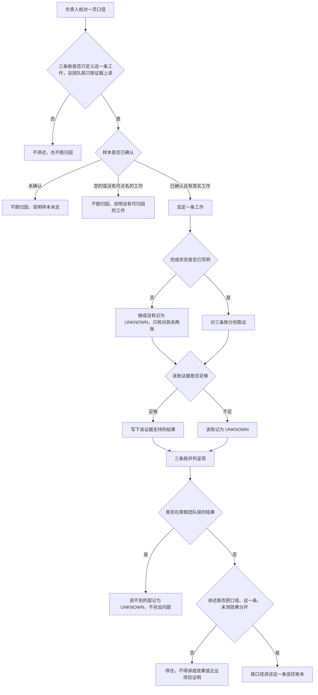

# AI Native 度量

## 1. 业务目标

负责人要以研发平台产品经理的判断，讲清一件事能不能交给 AI：做成没有、人被打扰几次、背景被补了几次。现在这三件事没有同一套说法。只看用了多少次、写了多少，回答不了它们；单独看一次交付花了多久，也看不出人被打断几次、背景被搬了几次。

本期做两件事。第一，给出一页可以一次讲完的口径：三条账只定义负责人自己的这一条工作；团队的 L1、L2、L3 只用这三条账的证据往上读，读不到的那一层记为 UNKNOWN。第二，在负责人自己的一个真实仓库或博客上，把一条工作读成这三条账。成功状态：阅读者只听这一页，就能复述三条账、取不到时的结果，以及这一条的证据怎样往上读到团队三层；样本能够读取时，这一条的三账并列出现，取不到的那一账写明无法判断。对照物是：没有这页口径时，缺失会被当成没发生，团队层会被写成三条账之外的问题。本期不测量 AI 是否提高了交付效果，也不把作品当作做过真实企业项目的证明。

已确认：取不到的账，结果是 UNKNOWN。它不能写成 0，也不能留空。手册案例里的效果数字没有基线、口径和对照，不作为实施理由，也不作为效果证据。检索后没有证据表明别的产品已经提供这三条账，故不把「竞品均已支持」写成实施理由。

假设：提交记录和发布记录只能支撑「做成没有」的一部分。打扰次数和补背景次数多半不在这些记录里。此假设不是已证实的数据结论。

待确认：样本仓库或博客尚未选定。已掌握、待决、责任人与期限见第 4 节。闭合前不把任何仓库写成已有样本，也不预填三条账的结果。

## 2. 业务结构

### 角色、场景与范围

- 角色：负责人写下口径，并在自己的样本上读取一条归因；阅读作品的人听这一页，并核对这一条结果有没有被讲成效果证明。阅读者不另定一套账。
- 场景：作品需要一次讲清「能不能信」。个人信任账本是最小样本，三条账只定义这一条工作。团队 L1、L2、L3 不另问，只说明怎样用这一条的证据往上读。
- 包含：一页口径；三条账（做成没有、打扰了几次、背景补了几次）；取不到时记为 UNKNOWN；在已确认的个人样本上只跑一条归因；口径中写明团队 L1、L2、L3 只用这三条账的证据往上读，读不到的层记为 UNKNOWN。
- 不包含：云端个人 Agent；思维图谱；完整的研发效能度量环境，以及把多系统数据收成团队看板；Agent 身份与权限治理；把「AI 是否进入」或「质量是否守住」写成三条账或团队层的问题；对团队层给出数字；对他人排名；测量或声称 AI 的交付效果；把作品说成做过的真实企业项目；用外部案例的效果数字充当本条证据；在样本未定时空仓库上预填结果。
- 依赖项（如有）：负责人自己的、已有真实工作记录的仓库或博客，尚未选定。提交记录和发布记录只在它们存在时，作为「做成没有」的部分证据。
- 本期无单独原型。口径是可以一次讲完的说明，不是界面。

### 流程与路径

负责人先核对一页口径：三条账必须只定义这一条工作；团队 L1、L2、L3 只能用这三条账的证据往上读；读不到的层必须是 UNKNOWN。说不成则不讲述，也不跑归因。说得成之后看样本。样本未确认，则不跑归因，并说明样本未定。样本是空的，或没有可点名的一条工作，则不跑归因，并说明没有可归因的工作。样本已确认且有真实工作，则选定一条工作。完成状态已经写明，才对照它判断做成没有；尚未写明，则不判做成或没做成，这一账为 UNKNOWN，打扰和补背景仍分别取证。每一账证据足够，就写下该证据支持的结果；证据不足，该账记为 UNKNOWN。三账并列。若有人索取团队层的结果，不另加问题，也不给出数字；这一条的证据读不到的层记为 UNKNOWN。讲述必须把口径、这一条结果、本期没有测量的效果分开；混在一起则停住，不得讲成效果或企业项目证明。

## 3. 用户故事

1. 作为负责人，在要说明这一条工作怎样被读到团队三层时，需要一页口径说清三条账只定义这一条工作、团队层只靠这些证据上读、读不到则为 UNKNOWN，以便阅读者不用第二份定义就能复述。
2. 作为负责人，在自己的一个真实仓库或博客上，需要把一条工作读成三条账，以便得到一份最小的信任账本，并且取不到的账有明确结果。
3. 作为阅读作品的人，在听这一页口径和这一条归因时，需要把口径、这一条样本的结果、尚未测量的效果分开，以便判断的是产品取舍，而不是一份企业效果证明。

## 4. 功能清单

| 能力 | 业务规则 | 对应故事 | 备注 |
|------|----------|----------|------|
| 一页口径 | 本期只提供一份可以一次讲完的口径。阅读者仅凭这一份，就能复述：三条账只定义这一条个人工作；取不到时结果为 UNKNOWN；团队 L1、L2、L3 只用这三条账的证据往上读，读不到的层为 UNKNOWN；本期只跑一条个人归因。不得靠另一套问题才能讲完。使用次数和代码行数不得作为三条账的结论 | 故事 1 | |
| 三条账 | 三条账只对纳入本期的一条个人工作作记录，不定义团队层。做成没有：对照事先写明的完成状态，结果为做成了、没做成或 UNKNOWN；代码写完或测试通过不算做成。打扰了几次：只计负责人能单独点名的一次注意力中断，中断来自 Agent 的通知、确认请求或未结束的等待。背景补了几次：只计负责人能单独点名的一次背景补充，补充的是 Agent 当时没有、而这件事要继续所需要的背景。取不到证据时，该账为 UNKNOWN。UNKNOWN 不得写成 0，也不得留空。只有另有证据表明确实没有发生，次数才为 0。假设：提交记录和发布记录只能支撑「做成没有」的一部分；打扰次数和补背景次数多半不在这些记录里。只靠提交记录时，后两账为 UNKNOWN，不得从「记录里没写」推出 0 | 故事 1、故事 2 | |
| 团队三层的读法 | L1、L2、L3 不更换三条账的含义，也不另加问题。团队三层只用这一条工作上三条账已经记下的证据往上读。某一层只靠这些证据读不出来时，该层为 UNKNOWN，不得写成 0，不得留空。不得改用「AI 是否进入」或「质量是否守住」来填写该层。本期只有这一条个人工作的证据，读不到团队层，因此 L1、L2、L3 均为 UNKNOWN。不对团队层给出数字，也不对他人排名 | 故事 1、故事 3 | |
| 一条归因 | 只选定一条工作。三账并列给出。某一账的证据不得填补另一账。样本未确认，或样本里没有可点名的工作，则不给出任何一账的结果 | 故事 2 | 未决。已掌握：样本必须是负责人自己的、已有真实工作记录的仓库或博客；izel-ai-native 是空仓库，不能当作这条归因的样本。待决：用哪一个仓库或博客。责任人：负责人。期限：选定样本并读取这一条归因之前。未给出日历日期。闭合前不把任一仓库写成已选样本 |
| 完成状态 | 读「做成没有」之前，必须写明这一条工作怎样算做成。未写明则不判做成或没做成，这一账为 UNKNOWN。代码写完或测试通过不得当作完成状态 | 故事 2 | 未决。已掌握：完成状态要在读账前写明，且不能只是代码写完或测试通过；提交记录和发布记录只是部分证据。待决：选定的这一条工作，以什么状态算做成。责任人：负责人。期限：判定「做成没有」之前。闭合前不把某一种发布形态写成规则 |
| 讲述边界 | 讲述分成三部分：口径是什么，这一条样本的结果是什么，哪些效果本期没有测量。不得把这一条，或外部案例的效果数字，讲成已测出的 AI 交付效果，或讲成做过真实企业项目 | 故事 3 | |

## 5. 边界与异常

| 情形 | 业务预期 |
|------|----------|
| 口径还不能讲清：三条账只定义这一条工作，团队层只靠这些证据上读，读不到则为 UNKNOWN | 不讲述，不跑归因，不给出任何账的结果 |
| 样本尚未确认 | 不跑归因，说明样本未定，不给出三条账数字 |
| 样本已确认，但是空的，或没有可点名的一条工作 | 不跑归因，说明没有可归因的工作。不把空写成 0，也不写成 UNKNOWN |
| 该账证据足够 | 写下该证据支持的结果：做成了、没做成，或可点名的次数 |
| 完成状态尚未写明 | 不判做成或没做成。「做成没有」为 UNKNOWN。打扰和补背景仍按各自证据分别给出 |
| 只有提交记录，发布记录也不足以证明完成状态 | 「做成没有」为 UNKNOWN。记录里没有打扰或补背景时，这两账也是 UNKNOWN，不得写成 0 |
| 打扰无法点名到具体次数 | 该账为 UNKNOWN，不写 0，不留空 |
| 补背景无法点名到具体次数 | 该账为 UNKNOWN，不写 0，不留空 |
| 另有证据表明打扰或补背景确实没有发生 | 该账次数为 0 |
| 只有部分账有证据 | 有证据的照实写，没有证据的为 UNKNOWN，不得用有证据的账填补 |
| 要求给出团队 L1、L2 或 L3 的结果 | 不另加问题，也不给出数字。这一条工作的三条账证据读不到的层，记为 UNKNOWN |
| 用「AI 是否进入」或「质量是否守住」填写某一团队层 | 不采纳。该层改记为 UNKNOWN。三条账仍只定义这一条个人工作 |
| 用外部案例的效果数字充当本条证据，或把这一条讲成 AI 交付效果或真实企业项目 | 不采纳这种讲法。口径、这一条结果、未测效果必须分开 |

## 6. 验收标准

1. 负责人出示一页口径后，阅读者能复述：三条账只问这一条个人工作的做成没有、打扰了几次、背景补了几次；L1、L2、L3 只用这三账的证据往上读，读不到的层是 UNKNOWN，不是「AI 是否进入」，也不是「质量是否守住」；本期只对这一条给出三账结果；提交记录和发布记录只能支撑「做成没有」的一部分，这是假设。（故事 1、故事 3）
2. 样本已确认，且这一条工作的完成状态已经写明时，负责人给出这一条的三条账。每一账要么是有证据的结果，要么是 UNKNOWN；三账并列，缺证据的账不被另外两账填上。（故事 2）
3. 阅读者能指出：作品没有把这一条归因，或外部案例中的效果数字，说成已测出的 AI 交付效果，也没有把它说成做过的真实企业项目。（故事 3）
4. 第 5 节各情形的业务预期即为该情形的验收。此处不逐条复述。

## 7. 术语表

| 术语 | 在本规格中的含义 | 不包括 | 边界 |
|------|------------------|--------|------|
| 三条账 | 只对负责人这一条工作要同时回答的三件事：做成没有、打扰了几次、背景补了几次 | 团队层的结论；「AI 是否进入」；「质量是否守住」；使用次数；代码行数 | 三账并列。某一账的结果不能填补另一账。团队层不能改写这三问 |
| 做成没有 | 这条工作有没有到达事先写明的完成状态 | 代码已经写完；测试已经通过 | 结果只为做成了、没做成或 UNKNOWN |
| 打扰 | 负责人被 Agent 的通知、确认请求或未结束的等待拉走一次注意力 | Agent 自行完成、人没有中断的过程；人并未中断的通知 | 一次就是负责人能单独点名的那一次中断 |
| 补背景 | 负责人为让这件事继续，向 Agent 补上它当时没有的背景 | Agent 自己已经掌握的内容 | 一次就是负责人能单独点名的那一次补充 |
| UNKNOWN | 这一问已经要回答，但证据不够，所以无法判断 | 数字 0；空白；没有发起这次度量 | 账取不到，或团队层读不到，都必须写下 UNKNOWN。0 只在另有证据表明确实没有发生时使用 |
| 信任账本 | 负责人自己的一条工作上的三条账，是这套口径的最小样本 | 团队层的读数；他人排名 | 第一期只跑一条。团队层不在这本账里另立问题 |
| 一条归因 | 把一条可点名的工作读成三条账 | 多条工作的汇总；空仓库上的预填 | 样本未确认时不存在这条归因 |
| 一页口径 | 一份可以一次讲完的口径说明 | 第二份定义；界面 | 阅读者只凭这一份就能复述第 6 节第 1 条 |
| L1 | 团队三层中的第一层。只用这一条工作的三条账证据往上读 | 「AI 是否进入」；使用次数；代码行数 | 证据读不到，则这一层为 UNKNOWN |
| L2 | 团队三层中的第二层。只用这一条工作的三条账证据往上读 | 「质量是否守住」 | 证据读不到，则这一层为 UNKNOWN |
| L3 | 团队三层中的第三层。只用这一条工作的三条账证据往上读 | 把「做成没有」直接写成团队交付结论 | 证据读不到，则这一层为 UNKNOWN |
| 证据 | 负责人能指认、且能对上这一账的记录或事实 | 外部案例的效果数字；另一账的结果；三条账之外的问题 | 指认不到，则该账为 UNKNOWN。这些证据读不到某一团队层，则该层为 UNKNOWN |

## 8. 决策日志

| 时间 | 变更点 | 理由 | 决策人 |
|------|--------|------|--------|
| 2026-10-15 | 确立本期只交付一页口径和一条个人归因。样本未确认，故事 2 与第 4 节不预填结果 | 作品要展示口径判断。空仓库跑不出归因，预填会把待确认写成事实 | 负责人 |
| 2026-10-15 | 口径定为三条账，只定义个人这一条工作。使用次数和代码行数不作为结论。团队三层如何上读，见本表最后一行 | 三条账对应能不能信、被打扰、补背景。团队层不另立问题 | 负责人 |
| 2026-10-15 | 取不到的账记为 UNKNOWN，不得记 0 或留空。0 只留给另有证据表明确实没有发生的次数 | 没有记录不等于没有发生。若不分开，缺失会被读成零 | 负责人 |
| 2026-10-15 | 假设单独标明：提交记录和发布记录只支撑「做成没有」的一部分；打扰和补背景多半不在其中 | 若不标明，阅读者会把 UNKNOWN 当成度量失败，或当成零 | 负责人 |
| 2026-10-15 | 「做成」必须对照事先写明的完成状态。代码写完或测试通过不算做成。具体完成状态等样本选定后再定，见第 4 节 | 测试通过仍可能对外不可用。样本未定，不能预先写死完成状态 | 负责人 |
| 2026-10-15 | 本期不交付云端个人 Agent、思维图谱、完整效能度量环境、Agent 身份与权限治理。不对团队出数，不对他人排名 | 这些会把一页口径和一条归因冲散，也超出作品要展示的范围 | 负责人 |
| 2026-10-15 | 手册等案例中的效果数字不进入实施理由，也不进入本条归因的证据。作品不声称测出 AI 交付效果，也不声称做过真实企业项目 | 这些数字没有基线、口径和对照。成功标准是让阅读者看到产品取舍 | 负责人 |
| 2026-10-15 | 更正团队三层的映射。故事 1、第 4 节「团队三层的读法」、流程、第 5 节、第 6 节第 1 条、术语中的三条账与 L1、L2、L3 改为：三条账只定义个人这一条工作；团队三层只用这三条账的证据往上读；读不到的层为 UNKNOWN。去掉把 L1 写成「AI 是否进入」、把 L2 写成「质量是否守住」 | 这两问不是三条账。一边说含义不更换，一边用它们填写团队层，口径会自相矛盾 | 负责人 |
